<div align="center">



*Which course needs the most academic support — and how does performance differ across batches?*

</div>

| | |
|---|---|
| **Author** | **Roshan Marathe** |
| **Student ID** | `10258` |
| **Assigned set** | **Set C** — Training Performance Analysis |
| **Repository** | `data-analysis-set-c-10258` |
| **Video walkthrough** | ### 📺 Project Demo & Walkthrough (12 min)


### 📺 Project Demo & Walkthrough (12 min)

[](https://drive.google.com/file/d/1qbXsycCnjoE_o8dlS18mCdh8BJyRu9IF/view)

💡 *Click above to watch the full project walkthrough on Google Drive.*


## 1. 🎯 Executive Summary

A training institute recorded **13 assessment rows** (one is an exact duplicate) across four courses, three batches and three months. The same cleaned dataset (**12 unique records**) was analysed independently in **Excel, MySQL, Python and Power BI**, and every headline number was reconciled across all four tools.


> [!IMPORTANT]
> **Answer 1 — Course needing the most support: `Python`** — lowest average score (**49.33**) and lowest pass rate (**33.33 %**, 1 of 3 assessments passed). No other course ties for the lowest value.
>
> **Answer 2 — Batch differences: `Evening` performs best (67.00), `Weekend` worst (56.25)** — a **10.75-point gap**. Weekend is also the only batch with a 50.00 % pass rate and the lowest attendance (75.75 %).

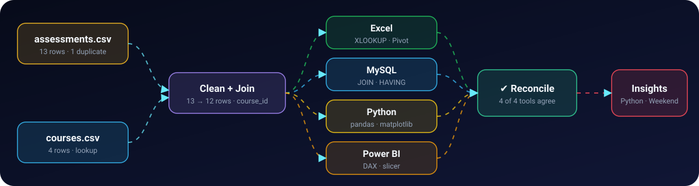


## 2. 🧭 Business Objective & Questions

**Objective:** identify where the institute should direct academic support, using a single, validated dataset and four independent analytical tools.

| # | Business question | Answer | Evidence |
|:-:|---|---|---|
| **Q1** | Which course needs the most academic support? | **Python** (Technology) | Lowest avg score **49.33** & lowest pass rate **33.33 %** (1/3) — [§10](#10--module-3--python), [§9 S2b](#s2b--underperforming-courses) |
| **Q2** | How does performance differ across batches? | **Evening 67.00 › Morning 61.25 › Weekend 56.25** | [§9 S2c](#s2c--top-two-batches-by-average-score), [§11](#11--module-4--power-bi) slicer test |

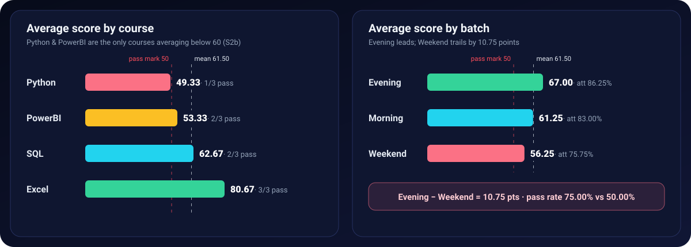

### Course ranking — *most support needed first*

| Priority | Course | Department | Assessments | Avg Score | Passed | Pass Rate | Avg Attendance | Score profile |
|:-:|---|---|:-:|:-:|:-:|:-:|:-:|---|
| 1 | **Python** | Technology | 3 | **49.33** | 1 / 3 | **33.33 %** | 71.00 % | `████████████` |
| 2 | PowerBI | Business | 3 | 53.33 | 2 / 3 | 66.67 % | 77.33 % | `█████████████` |
| 3 | SQL | Technology | 3 | 62.67 | 2 / 3 | 66.67 % | 84.00 % | `████████████████` |
| 4 | Excel | Business | 3 | 80.67 | 3 / 3 | 100.00 % | 94.33 % | `████████████████████` |

### Batch ranking

| Rank | Batch | Assessments | Avg Score | Passed | Pass Rate | Avg Attendance | Score profile |
|:-:|---|:-:|:-:|:-:|:-:|:-:|---|
| 1 | **Evening** | 4 | **67.00** | 3 / 4 | 75.00 % | 86.25 % | `█████████████████` |
| 2 | Morning | 4 | 61.25 | 3 / 4 | 75.00 % | 83.00 % | `███████████████` |
| 3 | **Weekend** | 4 | **56.25** | 2 / 4 | **50.00 %** | 75.75 % | `██████████████` |

*Bars are scaled 1 block = 4 score points. Pass rates are computed from underlying counts (passed ÷ total), never by averaging subgroup percentages.*


## 3. 🗂 Dataset & Data Dictionary

Synthetic datasets supplied with the exam — no external data was used.

| File | Location | Rows | Role |
|---|---|:-:|---|
| `assessments.csv` | `data/raw/` | **13** (12 unique + 1 duplicate) | **Fact table** — one row per assessment |
| `courses.csv` | `data/raw/` | **4** | **Lookup table** — one row per course |

> The raw files are preserved **exactly as supplied**. All cleaning happens downstream in each tool.

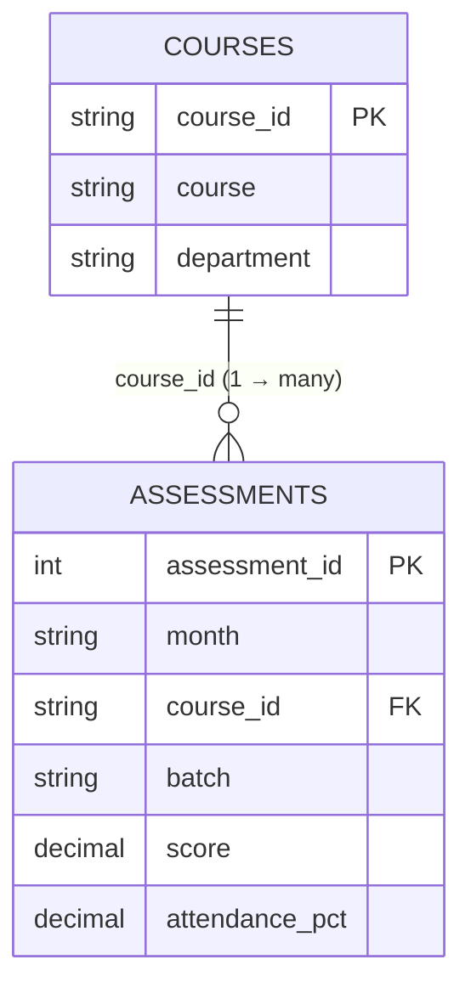

### `assessments.csv` — fact table

| Column | Type | Meaning | Allowed values / range |
|---|---|---|---|
| `assessment_id` | integer | Unique id of the assessment record | 1 – 12 |
| `month` | text (ordered) | Month the assessment took place | `Jan` → `Feb` → `Mar` |
| `course_id` | text | Foreign key to `courses.course_id` | `C1` – `C4` |
| `batch` | text | Class timing group | `Morning`, `Evening`, `Weekend` |
| `score` | numeric | Assessment score | 0 – 100 (observed 38 – 90) |
| `attendance_pct` | numeric | Attendance percentage | 0 – 100 (observed 60 – 98) |

### `courses.csv` — lookup table

| Column | Type | Meaning | Values |
|---|---|---|---|
| `course_id` | text (PK) | Lookup key | `C1` Excel · `C2` PowerBI · `C3` SQL · `C4` Python |
| `course` | text | Course name | Excel, PowerBI, SQL, Python |
| `department` | text | Owning department | `Business` (C1, C2) · `Technology` (C3, C4) |

### Derived fields

| Field | Defined in | Rule |
|---|---|---|
| `department`, `course` | all tools | Looked up from `courses` using `course_id` as the key |
| `pass_flag` | Excel, Python | `1` if `score >= 50`, else `0` — **a score of exactly 50 is a pass** |

### Data-quality checks

| Check | Result |
|---|---|
| Raw fact rows | **13** |
| Exact duplicate rows | **1** — `12,Mar,C4,Weekend,42,65` appears twice |
| Clean fact rows | **12** (all `assessment_id` 1–12 unique) |
| Missing values | **0** in every column |
| Unmatched `course_id` keys (fact → lookup) | **0** (verified in SQL S3/S3b, Python assertion, Excel XLOOKUP, Power BI relationship) |
| Scores / attendance on 0–100 scale | ✅ |
| Month order | Jan → Feb → Mar preserved in every pivot and chart |


## 4. 🧹 Cleaning Steps & Metric Definitions

### Cleaning steps (identical logic in all four tools)

1. **Load** the two raw files unchanged (13 + 4 rows).
2. **Set data types** — `assessment_id` integer; `score`, `attendance_pct` numeric; `month`, `course_id`, `batch`, `course`, `department` text.
3. **Remove the exact duplicate** (`assessment_id = 12` appears twice) → **13 → 12 rows**.
4. **Join** `assessments` ➜ `courses` on `course_id` (left join / lookup).
5. **Validate** the join: 12 rows remain and **0** rows have a missing department.
6. **Derive** `pass_flag = 1 if score >= 50 else 0` (Excel & Python); Power BI/SQL apply the same `>= 50` rule inside their measures/queries.

| Tool | How the duplicate is removed | Before → After |
|---|---|:-:|
| Excel | Duplicate row omitted from the `Clean` sheet; counts shown with `=ROWS()` | 13 → 12 |
| MySQL | Duplicate excluded at load time in `setup.sql` | 12 rows inserted |
| Python | `assessments.drop_duplicates()` | 13 → 12 |
| Power BI | Power Query ➜ **Remove Duplicates** (`Table.Distinct`) | 13 → 12 |

### Metric definitions

| Metric | Definition |
|---|---|
| **Assessment Count** | Number of assessment rows in the current filter context |
| **Average Score** | Mean of `score` over the rows in context |
| **Pass flag** | `score >= 50` → 1, otherwise 0 |
| **Pass Rate** | `passing assessments ÷ total assessments` — each row is an independent assessment, not a longitudinal student record |
| **Rounding** | All reported figures use two decimals; rates are calculated from counts, then rounded for display only |
| **Ties** | Highest/lowest results report *all* tied entities — no ties occurred for lowest course (Python) or top batch (Evening) |


## 5. 📁 Repository Structure

```text
data-analysis-set-c-YOUR-STUDENT-ID/
├── README.md                         ← you are here
├── requirements.txt                  ← Python packages
├── .gitignore                        ← excludes envs, caches, credentials, Office lock files
│
├── data/
│   └── raw/
│       ├── assessments.csv           ← supplied fact file (13 rows incl. 1 duplicate)
│       └── courses.csv               ← supplied lookup file (4 rows)
│
├── excel/
│   └── analysis.xlsx                 ← Raw · Lookup · Clean · Summary (live formulas + PivotTable)
│
├── sql/
│   ├── setup.sql                     ← schema + load of 12 fact / 4 lookup rows (run FIRST)
│   └── queries.sql                   ← S2a · S2b · S2c · S3 (+ S3b, R1 extras) (run SECOND)
│
├── python/
│   └── analysis.ipynb                ← clean → merge → derive → summarise → chart → export
│
├── powerbi/
│   └── dashboard.pbix                ← Power Query · model · 3 DAX measures · 1 report page
│
├── outputs/
│   ├── clean_data.csv                ← merged 12-row clean dataset (Python)
│   ├── python_summary.csv            ← department pass-rate summary (Python)
│   ├── python_chart.png              ← monthly average score chart (Python)
│   ├── powerbi_dashboard.png         ← unfiltered report page screenshot (Power BI)
│   ├── sql/                          ← saved results of every query (S2a, S2b, S2c, S3, S3b, R1)
│   └── screenshots/                  ← Excel & Power BI evidence images used in this README
│
├── tests/
│   └── validate_results.py           ← 22 automated cross-tool checks against the raw data
│
├── assets/                           ← hand-built animated SVGs used in this README
│   └── hero · kpis · pipeline · charts · trend · scatter · reconcile · module-* · divider
│
└── .github/workflows/
    └── validate.yml                  ← CI: re-runs the notebook + validation on every push
```


## 6. 🛠 Tools & Versions

| Tool | Version / detail |
|---|---|
| **Microsoft Excel** | Microsoft 365 (uses `XLOOKUP`, `COUNTIFS`, PivotTable) — *Help ▸ About for build* |
| **Power BI Desktop** | 2026 release (report theme `Fluent2-CY26SU08`) — *Help ▸ About for exact build* |
| **SQL engine** | **MySQL 9.6.0** (dialect and version also stated at the top of `setup.sql` and `queries.sql`) |
| **Python** | 3.13.5 (Anaconda base environment) |
| **Python packages** | `pandas`, `numpy`, `matplotlib`, `jupyterlab` — see [`requirements.txt`](requirements.txt) |
| **Automation** | GitHub Actions (`.github/workflows/validate.yml`) — notebook re-run + `tests/validate_results.py` |
| **Visual assets** | Hand-built animated SVGs in `assets/` — render natively on GitHub, no external services |
| **Version control** | Git / GitHub |
| **Video** | Screen + webcam recording (hosted link in the header table) |

Print your own package versions any time:

```bash
python -c "import pandas, numpy, matplotlib; print(pandas.__version__, numpy.__version__, matplotlib.__version__)"
```


## 7. ⚡ Quick Start — Reproduce Everything

Run the commands from the **repository root**.

```bash
# 0 · Clone
git clone https://github.com/YOUR-GITHUB-USERNAME/data-analysis-set-c-YOUR-STUDENT-ID.git
cd data-analysis-set-c-YOUR-STUDENT-ID

# 1 · SQL  (setup FIRST, queries SECOND)
mysql -u root -p < sql/setup.sql
mysql -u root -p < sql/queries.sql

# 2 · Python
python -m venv .venv && source .venv/bin/activate        # Windows: .venv\Scripts\activate
pip install -r requirements.txt
jupyter nbconvert --to notebook --execute --inplace --ExecutePreprocessor.kernel_name=python3 python/analysis.ipynb

# 3 · Validate every number against the raw data (22 checks)
python tests/validate_results.py
```

| Module | Open this file | Notes |
|---|---|---|
| 📗 Excel | `excel/analysis.xlsx` | Formulas & PivotTable are live — nothing to configure |
| 🗄 SQL | `sql/setup.sql` → `sql/queries.sql` | Detailed steps in [§9](#9--module-2--sql-mysql) |
| 🐍 Python | `python/analysis.ipynb` | Works from repo root **or** from `python/`; details in [§10](#10--module-3--python) |
| 📊 Power BI | `powerbi/dashboard.pbix` | **Update the two CSV paths after cloning** — [§11](#data-source--refresh-instructions--after-cloning) |

<details>
<summary><strong>🧰 Troubleshooting</strong></summary>

| Symptom | Fix |
|---|---|
| MySQL `ERROR 1215: Cannot add foreign key constraint` | Run **`setup.sql` first** — it creates `courses` before `assessments`. Never run `queries.sql` on an empty database. |
| `No such kernel named conda-base-py` | Add `--ExecutePreprocessor.kernel_name=python3` (as above) or pick any Python 3 kernel in Jupyter. |
| `FileNotFoundError: data/raw/assessments.csv` | Start the notebook from the repo root (or from `python/`) and keep the `data/raw/` folder where it is. |
| Power BI: *DataSource.Error – could not find file* | Re-point **both** CSV sources — [refresh steps](#data-source--refresh-instructions--after-cloning). |
| Excel shows `#NAME?` for `XLOOKUP` | Needs Excel 2021 / Microsoft 365; the `INDEX/MATCH` equivalent returns the same result. |
| Animations look static | GitHub plays the SVG animations in the browser; some previewers (e-mail, IDE panes) show a still frame. |

</details>


## 8. 📗 Module 1 — Excel


**File:** [`excel/analysis.xlsx`](excel/analysis.xlsx) · all calculations are **live formulas**; the PivotTable and chart are editable (no screenshots-only deliverables).

### Sheet guide

| Sheet | What it does | Rows |
|---|---|:-:|
| **Raw** | Original `assessments.csv` pasted **unchanged** (duplicate included) | 13 |
| **Lookup** | Original `courses.csv` — the `course_id → course, department` key | 4 |
| **Clean** | De-duplicated data + `Department` (XLOOKUP) + `pass_flag` (IF) + before/after row counts | 12 |
| **Summary** | `COUNTIFS` pass counts by batch · PivotTable (department × month) · column chart | — |

### Formulas used

| Purpose | Cell | Formula |
|---|:-:|---|
| Department lookup | `Clean!G2:G13` | `=XLOOKUP(C2, Lookup!$A$2:$A$5, Lookup!$C$2:$C$5)` |
| Pass flag | `Clean!H2:H13` | `=IF(E2>=50, 1, 0)` |
| Row count **before** | `Clean!C17` | `=ROWS(Raw!A2:F14)` → **13** |
| Row count **after** | `Clean!E17` | `=ROWS(A2:H13)` → **12** |
| Passing assessments per batch | `Summary!B2:B4` | `=COUNTIFS(Clean!D:D, A2, Clean!H:H, 1)` |

### E1 — Import & cleaning · output

| Before (Raw) | After (Clean) | Duplicate removed |
|:-:|:-:|---|
| **13** rows | **12** rows | `12, Mar, C4, Weekend, 42, 65` |

### E2 — Derived field & batch summary · output

`pass_flag` is applied to all 12 rows. `COUNTIFS` result (passing assessments by batch):

| Batch | Passing assessments | Total | Pass rate |
|---|:-:|:-:|:-:|
| Morning | **3** | 4 | 75.00 % |
| Evening | **3** | 4 | 75.00 % |
| Weekend | **2** | 4 | 50.00 % |
| **Total** | **8** | **12** | **66.67 %** |

### E3 — PivotTable & chart · output

**PivotTable** — *Average of score*, rows = **department**, columns = **month** (Jan → Feb → Mar):

| Department | Jan | Feb | Mar | **Grand Total** |
|---|:-:|:-:|:-:|:-:|
| Business | 58.50 | 67.50 | 75.00 | **67.00** |
| Technology | 51.50 | 58.00 | 58.50 | **56.00** |
| **Grand Total** | **55.00** | **62.75** | **66.75** | **61.50** |

**Chart** — clustered column chart built from the PivotTable, placed on the `Summary` sheet: title *Avg Score By Department*, category axis **Department**, value axis **Average Score**, legend showing **Jan / Feb / Mar**.

<p align="center">
  
</p>
<p align="center"><em>Figure 8.3 — Summary sheet: COUNTIFS table, PivotTable and chart.</em></p>


**Excel takeaways:** Business outscores Technology in every month; both departments improve from January to March; the overall monthly average rises **55.00 → 62.75 → 66.75**.


## 9. 🗄 Module 2 — SQL (MySQL)


| Item | Value |
|---|---|
| **SQL dialect** | MySQL |
| **Server version** | **9.6.0** |
| **Database** | `training_performance` |
| **Files** | [`sql/setup.sql`](sql/setup.sql) · [`sql/queries.sql`](sql/queries.sql) |
| **Saved results** | [`outputs/sql/`](outputs/sql/) |

### Query execution order

| Step | File | What happens | Expected |
|:-:|---|---|---|
| 1 | `sql/setup.sql` | Creates DB, drops/creates tables, loads data | `courses = 4`, `assessments = 12` |
| 2 | `sql/queries.sql` | S2a → S2b → S2c → S3 (+ S3b, R1) | results below |

```bash
mysql -u root -p < sql/setup.sql
mysql -u root -p < sql/queries.sql
```

*MySQL Workbench alternative:* **File ▸ Open SQL Script** → run `setup.sql`, then `queries.sql`; export each result grid via **Export ▸ CSV** into `outputs/sql/`.

### S1 — Table definitions & data load

```sql
CREATE TABLE courses (
    course_id   VARCHAR(10) PRIMARY KEY,
    course      VARCHAR(50) NOT NULL,
    department  VARCHAR(50) NOT NULL
);

CREATE TABLE assessments (
    assessment_id   INT PRIMARY KEY,
    month           VARCHAR(10)  NOT NULL,
    course_id       VARCHAR(10)  NOT NULL,
    batch           VARCHAR(20)  NOT NULL,
    score           DECIMAL(5,2) NOT NULL,
    attendance_pct  DECIMAL(5,2) NOT NULL,
    CONSTRAINT fk_assessments_course
        FOREIGN KEY (course_id) REFERENCES courses (course_id)
);
```

| Design decision | Why |
|---|---|
| `PRIMARY KEY` on `assessment_id` / `course_id` | Blocks the duplicate row from ever being inserted twice |
| `FOREIGN KEY assessments.course_id → courses.course_id` | Guarantees referential integrity (zero unmatched keys) |
| `DECIMAL(5,2)` for score & attendance | Exact two-decimal numerics on a 0–100 scale — no floating-point drift |
| `DROP TABLE IF EXISTS` (child first) | `setup.sql` is re-runnable from any state |
| Inserts **12 + 4** rows | Duplicate excluded at load time; values copied exactly from `data/raw/` |

### S2a — Average score by department

```sql
SELECT c.department, ROUND(AVG(a.score), 2) AS avg_score
FROM assessments AS a
JOIN courses     AS c ON a.course_id = c.course_id
GROUP BY c.department
ORDER BY AVG(a.score) ASC;          -- lowest first = highlights under-performance
```

| department | avg_score |
|---|:-:|
| Technology | **56.00** |
| Business | **67.00** |

📄 `outputs/sql/s2a_avg_score_by_department.csv`

### S2b — Underperforming courses

```sql
SELECT c.course, ROUND(AVG(a.score), 2) AS avg_score
FROM assessments AS a
JOIN courses     AS c ON a.course_id = c.course_id
GROUP BY c.course
HAVING AVG(a.score) < 60
ORDER BY AVG(a.score) ASC;
```

| course | avg_score |
|---|:-:|
| Python | **49.33** |
| PowerBI | **53.33** |

📄 `outputs/sql/s2b_underperforming_courses.csv` — `HAVING` filters *after* aggregation, so the threshold applies to each course's mean, not to individual rows. Excel (80.67) and SQL (62.67) stay above 60.

### S2c — Top two batches by average score

```sql
SELECT batch, ROUND(AVG(score), 2) AS avg_score
FROM assessments
GROUP BY batch
ORDER BY AVG(score) DESC, batch ASC     -- ties broken alphabetically
LIMIT 2;
```

| batch | avg_score |
|---|:-:|
| Evening | **67.00** |
| Morning | **61.25** |

📄 `outputs/sql/s2c_top_two_batches_by_avg_score.csv` — Weekend (56.25) is third. No tie occurred, so the alphabetical rule was not triggered.

### S3 — Data integrity check

```sql
SELECT c.course_id, c.course, a.assessment_id
FROM courses AS c
LEFT JOIN assessments AS a ON c.course_id = a.course_id
WHERE a.course_id IS NULL;
```

**Result: empty set (0 rows)** → every course in the lookup is matched by assessments; nothing is orphaned. 📄 `outputs/sql/s3_data_integrity_check.csv`

<details>
<summary><strong>Extra checks (S3b, R1)</strong></summary>

| Query | Purpose | Result |
|---|---|---|
| **S3b** — `assessments LEFT JOIN courses … WHERE c.course_id IS NULL` | Direction the brief cares about: any fact `course_id` **without** a lookup row? | **0 rows** ✅ |
| **R1** — `COUNT(*)`, `SUM(score >= 50)`, `ROUND(100.0 * SUM(score >= 50) / COUNT(*), 2)` | Overall pass rate for the [reconciliation](#13--cross-tool-reconciliation--automated-validation) | `12 · 8 · 66.67` ✅ |

</details>


## 10. 🐍 Module 3 — Python


**File:** [`python/analysis.ipynb`](python/analysis.ipynb) — pandas + matplotlib. All paths are **relative to the repository root** (the first cell switches into the root automatically if the notebook is launched from `python/`).

### Environment & run instructions

```bash
python -m venv .venv && source .venv/bin/activate      # Windows: .venv\Scripts\activate
pip install -r requirements.txt

jupyter lab python/analysis.ipynb                      # Kernel ▸ Restart & Run All
# …or headless, from the repo root:
jupyter nbconvert --to notebook --execute --inplace --ExecutePreprocessor.kernel_name=python3 python/analysis.ipynb
```

### Pipeline

| Step | Rubric | Code | Printed output |
|---|:-:|---|---|
| Load with relative paths | P1 | `pd.read_csv('data/raw/assessments.csv')` | `assessments: (13, 6)` · `courses: (4, 3)` |
| Confirm numeric types | P1 | `assessments[['score','attendance_pct']].dtypes` | both `int64` |
| Remove exact duplicate | P1 | `assessments.drop_duplicates()` | `Before : 13` → `After: 12` |
| Left-join merge | P1 | `assessments.merge(courses, on='course_id', how='left')` | shape `(12, 8)` |
| Assert integrity | P1 | `assert len(merged) == 12` · `assert merged['department'].isna().sum() == 0` | `All course_id values matched.` |
| Derive `pass_flag` | P2 | `(merged['score'] >= 50).astype(int)` | 8 ones, 4 zeros |
| Department summary | P2 | `groupby('department').agg(...)` | table below |
| Lowest-pass-rate course | P2 | `course_summary['pass_rate'].idxmin()` | **Python — 1 passed of 3** |
| Monthly chart (Jan→Feb→Mar) | P3 | `reindex(['Jan','Feb','Mar'])` → bar chart | saved PNG |
| Exports | P3 | `to_csv(...)` | 2 CSV files |

### P2 — Department summary (`outputs/python_summary.csv`)

| department | total_assessments | passed | pass_rate (%) |
|---|:-:|:-:|:-:|
| Business | 6 | 5 | **83.33** |
| Technology | 6 | 3 | **50.00** |

### P2 — Course summary & the lowest pass rate

| course | total | passed | pass_rate (%) |
|---|:-:|:-:|:-:|
| Excel | 3 | 3 | 100.00 |
| PowerBI | 3 | 2 | 66.67 |
| **Python** | **3** | **1** | **33.33** ← lowest |
| SQL | 3 | 2 | 66.67 |

```text
Lowest pass rate course: Python
Passing count: 1
Total assessments: 3
```

**Numerator = 1 passing assessment** (Feb · Evening · score 68) **· Denominator = 3 Python assessments** (scores 38, 68, 42) → **1 ÷ 3 = 33.33 %**. No other course shares the lowest rate.

### P3 — Chart

<p align="center">
  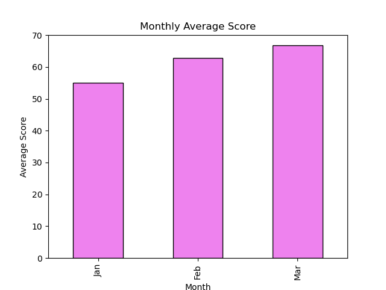
</p>

| Month | Jan | Feb | Mar |
|---|:-:|:-:|:-:|
| **Avg score** | 55.00 | 62.75 | 66.75 |

### P3 — Exports

| File | Content | Rows |
|---|---|:-:|
| [`outputs/clean_data.csv`](outputs/clean_data.csv) | Merged clean dataset with `course`, `department`, `pass_flag` | 12 |
| [`outputs/python_summary.csv`](outputs/python_summary.csv) | Department count / passed / pass-rate summary | 2 |
| [`outputs/python_chart.png`](outputs/python_chart.png) | Labeled monthly average-score chart | — |

A final helper cell prints `Business 67.00 · Technology 56.00` (average score by department) and `Overall pass rate: 8 / 12 = 66.67%` for the [reconciliation](#13--cross-tool-reconciliation--automated-validation). The committed notebook contains **all executed outputs**.


## 11. 📊 Module 4 — Power BI


**File:** [`powerbi/dashboard.pbix`](powerbi/dashboard.pbix) · one report page, **Training Performance Analysis Dashboard** (1920 × 1080).

<p align="center">
  
</p>
<p align="center"><em>Figure 11.1 — Completed report page, <strong>unfiltered</strong> state.</em></p>


### B1 — Power Query & data model

**Power Query (applied steps)**

| Query | Steps | Result |
|---|---|---|
| `assessments` | Source (CSV) → Promoted Headers → **Changed Type** (`assessment_id`, `score`, `attendance_pct` = Whole Number; `month`, `course_id`, `batch` = Text) → **Removed Duplicates** | **12 rows** |
| `courses` | Source (CSV) → Changed Type (all Text) → Renamed Columns → Removed Top Rows (header row) | **4 rows** |


**Data model**

| From | To | Cardinality | Filter direction | Active |
|---|---|:-:|:-:|:-:|
| `courses[course_id]` | `assessments[course_id]` | **1 : many** | Single (courses → assessments) | ✅ |
| `Dim_Date[Month]` | `assessments[month]` | **1 : many** | Single (Dim_Date → assessments) | ✅ |

`Dim_Date` is a small calculated table (`Jan 1 · Feb 2 · Mar 3`) whose **Month** column is *sorted by Month Number*, which keeps every chart in true Jan → Feb → Mar order. `Measure` is the dedicated measures table.

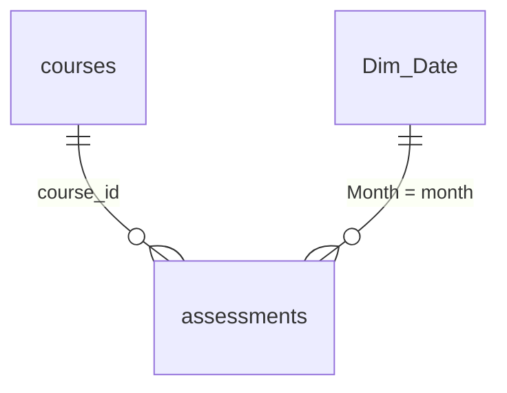


### B2 — DAX measures (table `Measure`)

```dax
Assessment Count = COUNTROWS ( assessments )

Avg Score        = AVERAGE ( assessments[score] )

Pass Rate        = DIVIDE (
                       CALCULATE ( COUNTROWS ( assessments ), assessments[score] >= 50 ),
                       COUNTROWS ( assessments )
                   )                                   // returned as a decimal, formatted 0.00 %
```

All three are **explicit measures**, so they respond to every slicer, cross-filter and visual filter on the page. `Pass Rate` is equivalent to the brief's `DIVIDE(COUNTROWS(FILTER(assessments, assessments[score] >= 50)), COUNTROWS(assessments), 0)` — both count rows with `score >= 50` ÷ all rows.


### B3 — Report page

| # | Element | Fields | Purpose |
|:-:|---|---|---|
| 1 | **KPI card** | `Assessment Count` | Volume of assessments in context |
| 2 | **KPI card** | `Avg Score` (2 decimals) | Mean score |
| 3 | **KPI card** | `Pass Rate` (`0.00 %`) | Share of passing assessments |
| 4 | **Clustered column chart** | Axis `courses[department]` · Values `Avg Score`, `Pass Rate` | Department comparison |
| 5 | **Monthly trend (line)** | Axis `Dim_Date[Month]` · Values `Avg Score` | Jan → Feb → Mar trend |
| 6 | **Batch slicer** | `assessments[batch]` | Filters **all** cards and charts simultaneously |
| 7 | Title & logo | Text box · image | Branding / readability |

### Slicer demonstration (filtered-state test)

Selecting a batch re-computes every card and chart. Card values recorded for the test (Weekend) and for the other states:

| Slicer state | Assessment Count | Avg Score | Pass Rate |
|---|:-:|:-:|:-:|
| **None (cleared / unfiltered)** | **12** | **61.50** | **66.67 %** |
| **Weekend** *(tested state)* | 4 | 56.25 | 50.00 % |
| Morning | 4 | 61.25 | 75.00 % |
| Evening | 4 | 67.00 | 75.00 % |


### Findings read from the unfiltered report

1. **Technology averages 56.00 vs Business 67.00** — an 11.00-point gap; pass rate **50.00 % vs 83.33 %**.
2. **Overall pass rate is 66.67 % (8 of 12)** with an average score of **61.50**; the monthly trend climbs **55.00 → 62.75 → 66.75**.

**Recommendation:** see [§12](#12--insights-findings--recommendation).

### Data source & refresh instructions — *after cloning*

Power BI stores **absolute file paths**, so the two CSV sources must be re-pointed once on every new computer.

| Query | Point it to |
|---|---|
| `assessments` | `<your-clone-folder>\data\raw\assessments.csv` |
| `courses` | `<your-clone-folder>\data\raw\courses.csv` |

1. Open `powerbi/dashboard.pbix` in Power BI Desktop (Windows).
2. **Home ▸ Transform data ▸ Data source settings**.
3. Select the first CSV ▸ **Change Source…** ▸ **Browse** to `data\raw\assessments.csv` ▸ **OK**. Repeat for `courses.csv`.
4. **Close** ▸ **Apply changes**, then **Home ▸ Refresh**.
5. Verify the cards read **12 · 61.50 · 66.67 %** with no filters applied.

*Alternative:* Power Query Editor ▸ select the query ▸ **Advanced Editor** ▸ edit the `File.Contents("…")` path.


## 12. 🔬 Insights, Findings & Recommendation

### 📈 Insight lab

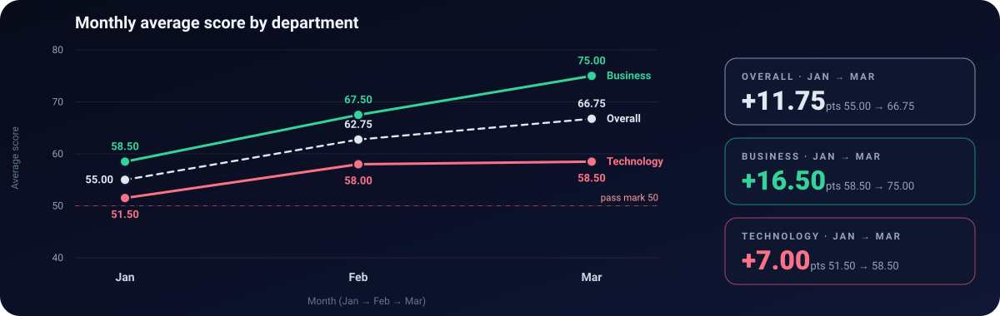

Both departments improve every month, but **Business climbs much faster (+16.50 points) than Technology (+7.00)**, so the department gap widens from 7.00 points in January to 16.50 in March (Technology plateaus at 58.00 → 58.50 between February and March).


> [!TIP]
> **Attendance is a clean early-warning signal in this data.** All **4 failing** assessments had attendance **≤ 75 %**, and all **8 passing** assessments had attendance **≥ 80 %** — the two groups do not overlap at all (score–attendance correlation **r = 0.98**, n = 12; descriptive only).

**Course × batch heat-map** — average score per cell (🟩 ≥ 70 · 🟨 50–69 · 🟥 < 50 · — no assessment)

| Course | Morning | Evening | Weekend |
|---|:-:|:-:|:-:|
| **Excel** | 🟩 72.00 | 🟩 80.00 | 🟩 90.00 |
| **PowerBI** | 🟨 60.00 | 🟥 45.00 | 🟨 55.00 |
| **SQL** | 🟨 56.50 ¹ | 🟩 75.00 | — |
| **Python** | — | 🟨 68.00 | 🟥 40.00 ¹ |

<sub>¹ average of two assessments; every other cell is a single assessment.</sub>

**The four failing assessments**

| ID | Month | Course | Batch | Score | Attendance |
|:-:|:-:|---|---|:-:|:-:|
| 2 | Jan | PowerBI | Evening | 45 | 70 % |
| 4 | Jan | **Python** | Weekend | 38 | 60 % |
| 7 | Feb | SQL | Morning | 48 | 75 % |
| 12 | Mar | **Python** | Weekend | 42 | 65 % |

**Score distribution (n = 12)**

| Mean | Median | Std. dev. | Min | Q1 | Q3 | Max |
|:-:|:-:|:-:|:-:|:-:|:-:|:-:|
| 61.50 | 62.50 | 16.33 | 38 | 47.25 | 72.75 | 90 |

### Two numeric findings

| # | Finding | Numbers |
|:-:|---|---|
| **F1** | **Python is the weakest course** on both measures | Average score **49.33** (all-course mean 61.50); pass rate **33.33 %** — only **1 of 3** assessments passed |
| **F2** | **Weekend is the weakest batch; Evening the strongest** | Weekend avg **56.25** (pass rate 50.00 %) vs Evening **67.00** — a **10.75-point** gap |

### Supporting observations

- **Department gap:** Technology **56.00** vs Business **67.00**; Technology's two courses (Python 49.33, SQL 62.67) both sit below Excel (80.67).
- **Python's problem is concentrated in the Weekend batch:** both Weekend Python assessments failed (**38** and **42**, mean **40.00**), while the Evening Python assessment passed (**68**).
- **Trend is positive:** the monthly average rises from **55.00** (Jan) to **66.75** (Mar), **+11.75 points**.
- **Attendance tracks performance:** Weekend has the lowest attendance (**75.75 %**) and Evening the highest (**86.25 %**) — the same order as their scores.

### ✅ Recommendation

> **Prioritise academic support for Python, starting with the Weekend batch.** Add structured practice/mentoring sessions and attendance follow-up for Weekend Python learners — both Weekend Python results were failures, with low attendance (60 % and 65 %). Use **attendance below 80 %** as an early-warning trigger for outreach before the next assessment. Review **PowerBI (avg 53.33)** as the second priority; **Excel (avg 80.67, 100 % pass)** needs no intervention and can serve as the benchmark course.

### ⚠️ Limitation

The dataset is **synthetic and tiny (12 records, 3 per course)** and each course–batch combination has at most **one** assessment (two for SQL-Morning and Python-Weekend), so a *course* effect cannot be separated from a *batch* effect. Each row is an independent assessment (not a student's journey), so the results show **where to look**, not **why** — and the attendance relationship is correlation, not causation. Confirm with a larger, student-level dataset before committing resources.


## 13. 🔁 Cross-Tool Reconciliation & Automated Validation


Every aggregate below was computed independently in each tool and **matches exactly**.

### A · Technology department — average score = **56.00**

| Tool | Where it comes from | Value |
|---|---|:-:|
| 📗 Excel | PivotTable → Technology **Grand Total** | **56.00** |
| 🗄 SQL | `S2a` → `Technology` row | **56.00** |
| 🐍 Python | `merged.groupby('department')['score'].mean()` | **56.00** |
| 📊 Power BI | `Avg Score` card with *Technology* selected in the department chart | **56.00** |

### B · Overall pass rate — **8 / 12 = 66.67 %**

| Tool | Where it comes from | Passing | Total | Rate |
|---|---|:-:|:-:|:-:|
| 📗 Excel | `COUNTIFS` by batch: 3 + 3 + 2 | **8** | 12 | 66.67 % |
| 🗄 SQL | `R1` query | **8** | 12 | 66.67 % |
| 🐍 Python | `merged['pass_flag'].sum()` of 12 rows | **8** | 12 | 66.67 % |
| 📊 Power BI | `Pass Rate` card (unfiltered) | — | 12 | 66.67 % |

### C · Technology pass rate — **3 / 6 = 50.00 %** *(Python summary vs Power BI)*

| Python `python_summary.csv` | Power BI card (*Technology*) |
|:-:|:-:|
| 3 of 6 → **50.00 %** | **50.00 %** |

### Rounding notes

- **SQL** rounds with `ROUND(AVG(...), 2)` on `DECIMAL(5,2)`; **Python** keeps full precision internally (e.g. `83.333333…`) and rounds to two decimals for export/display.
- **Excel** PivotTable shows `67` / `56` unless the number format is set to 2 decimals — the underlying values are identical (`67.00`, `56.00`).
- **Power BI** `Pass Rate` is a decimal (`0.6667`) formatted as **66.67 %**; `Avg Score` is displayed to two decimals.
- **No rounding differences** affect any reconciled value.

### 🤖 Automated validation

`tests/validate_results.py` recomputes every headline number **straight from `data/raw/`** and compares it with the files each tool produced — so the reconciliation above is re-checked by code, not by eye.

| Check group | Checks | What is verified |
|---|:-:|---|
| Raw data & cleaning | 5 | 13 raw rows · exactly 1 duplicate · 4 lookup rows · 12 clean rows · 0 unmatched `course_id` |
| Python exports | 4 | `clean_data.csv` (12 rows, `pass_flag` rule) · `python_summary.csv` (Business 5/6, Technology 3/6) |
| SQL outputs | 10 | S2a values & order · S2b set & values · S2c top-two · S3 / S3b empty · R1 overall pass rate |
| Excel workbook | 3 | Sheets present · `COUNTIFS` = 3 / 3 / 2 · PivotTable Technology total 56.00 *(skipped if the file is absent)* |
| **Total** | **22** | |

```bash
python tests/validate_results.py
# …
# 22/22 checks passed
```

The same script runs in **GitHub Actions** (`.github/workflows/validate.yml`) after the notebook is re-executed headlessly on a clean Ubuntu runner on **every push** — the **validate** badge at the top of this README is its live result. Power BI is a binary file and cannot be tested in CI, so it is reconciled manually in tables A–C above.


## 14. 🎬 Video Walkthrough

| Item | Value |
|---|---|
| **Video URL** | ### 📺 Project Demo & Walkthrough (12 min)


### 📺 Project Demo & Walkthrough (12 min)

[](https://drive.google.com/file/d/1qbXsycCnjoE_o8dlS18mCdh8BJyRu9IF/view)
💡 *Click above to watch the full project walkthrough on Google Drive.*
| **Duration** | `12 min`|
| **Format** | Webcam overlay + screen recording, face visible throughout |

**Walkthrough outline**

| Time | Segment | Shows |
|:-:|---|---|
| 0:00 | Introduction | Name, student ID, **Set C**, business question |
| 0:45 | Dataset & cleaning | Two files, the duplicate row (13 → 12), key rules |
| 2:00 | 📗 Excel | `XLOOKUP`, `IF` pass_flag, `COUNTIFS`, PivotTable |
| 3:30 | 🗄 SQL | One query live (e.g. S2a) + integrity check |
| 5:00 | 🐍 Python | Merge assertion, `pass_flag`, chart |
| 6:30 | 📊 Power BI | A DAX measure, batch slicer, reading a card value |
| 8:30 | Conclusion | Two numeric findings, recommendation, limitation, repo tour |


## References & Authorship

**References**

- Microsoft Learn — [`XLOOKUP`](https://support.microsoft.com/office/xlookup-function-b7fd680e-6d10-43e6-84f9-88eae8bf5929), [`COUNTIFS`](https://support.microsoft.com/office/countifs-function-dda3dc6e-f74e-4aee-88bc-aa8c2a866842), [PivotTables](https://support.microsoft.com/office/overview-of-pivottables-and-pivotcharts-527c8fa3-02c0-445a-a2db-7794676bce96)
- Microsoft Learn — [DAX reference](https://learn.microsoft.com/dax/) (`DIVIDE`, `CALCULATE`, `COUNTROWS`, `AVERAGE`) and [Power Query M](https://learn.microsoft.com/powerquery-m/)
- MySQL 9.x Reference Manual — [`JOIN`](https://dev.mysql.com/doc/refman/9.0/en/join.html), [`GROUP BY` / `HAVING`](https://dev.mysql.com/doc/refman/9.0/en/group-by-handling.html)
- pandas documentation — [`merge`](https://pandas.pydata.org/docs/reference/api/pandas.DataFrame.merge.html), [`drop_duplicates`](https://pandas.pydata.org/docs/reference/api/pandas.DataFrame.drop_duplicates.html), [`groupby`](https://pandas.pydata.org/docs/reference/api/pandas.DataFrame.groupby.html)
- AI assistance: README drafting and formatting support from Claude (Anthropic).

**Authorship declaration**

> All work in this repository is my own except where cited.
>
> — **Roshan Marathe** · Student ID `10258` · Set C

<div align="center">

*"Quality is our Motto."* · Practical Exam — Data Analysis (Set C)

</div>
